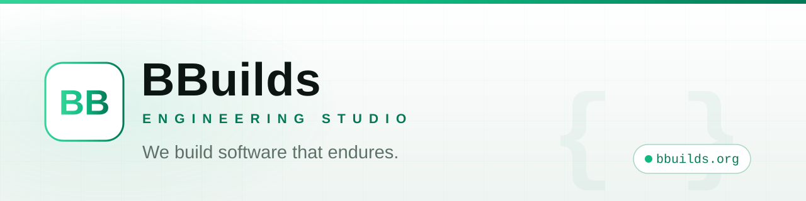

<picture>
  <source media="(prefers-color-scheme: dark)" srcset="assets/banner-dark.svg" />
  <source media="(prefers-color-scheme: light)" srcset="assets/banner-light.svg" />
  
</picture>

### The engineering studio for products that need to last.

**BBuilds** designs, builds, and ships web, mobile, and backend software for founders and ambitious teams — from the first sketch to production-grade reality.

---

## What we build

| | |
|:---|:---|
| **Web Applications** | Fast, accessible products — from marketing sites to complex dashboards. |
| **Mobile Apps** | Native-quality iOS and Android experiences from a single codebase. |
| **APIs & Backends** | Scalable services, clean data models, and integrations that hold up. |
| **Cloud & DevOps** | CI/CD, infrastructure, and observability — shipped with confidence. |
| **UI Engineering** | Design systems and interfaces with polish down to the pixel. |
| **Technical Strategy** | Architecture reviews, roadmaps, and build-vs-buy decisions. |

## How we work

1. **Discover** — understand the problem, the users, and the constraints before writing a line of code.
2. **Design** — from wireframes to polished specs, agreed before engineering begins.
3. **Build** — tight iterations, weekly demos, and code you can still read six months later.
4. **Ship** — production releases with CI/CD, monitoring, and documentation.
5. **Support** — we stay accountable after launch: maintain, measure, improve.

## Core stack

## Public repositories

> Public projects, open-source tooling, and our engineering handbook will appear here as they are ready to ship.

Selected client work is showcased at **[bbuilds.org](https://bbuilds.org)**.

## Work with us

Have a product to build? Tell us what you're making.

| | |
|:---|:---|
| **Website** | [bbuilds.org](https://bbuilds.org) |
| **Email** | [support@bbuilds.org](mailto:support@bbuilds.org) |
| **Location** | India · remote-friendly |

---

© 2026 BBuilds · <a href="https://bbuilds.org">bbuilds.org</a>

